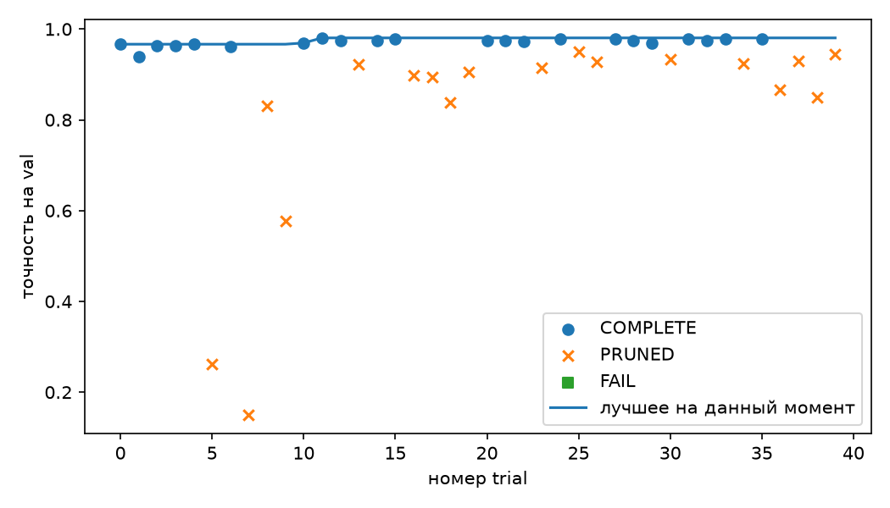
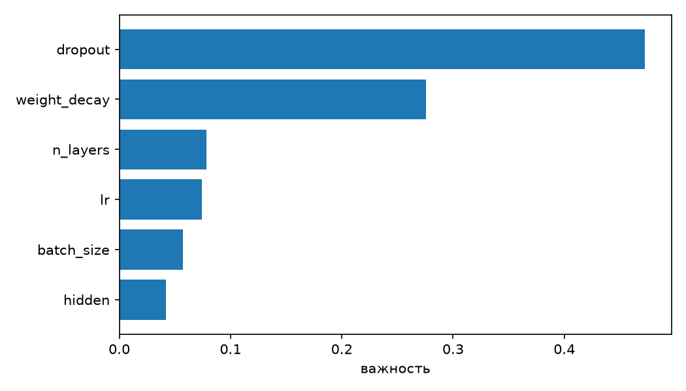

# Лабораторная работа 0. Воспроизводимый эксперимент

Вопрос: дал ли подбор гиперпараметров прирост больше случайного разброса по seed?

Прогноз был записан до обучения. Ожидалась точность базы на val около 95–96% и разброс пяти seed меньше 1 п.п., около 0,5 п.п. Лучший trial на val при seed 0 должен был обогнать базу на 1–2 п.п. На seed 101–105 и на test этот прирост должен был сжаться; все пять разностей на test не ожидались одновременно положительными и большими, чем разброс эксперимента 1.

Разбиение одно: 1077 / 360 / 360, `split_seed = 0`. Знаменатель точности на val и на test — 360 изображений. Одно изображение — 0,28 п.п.

## Что сделано

Каркас одной командой обучает MLP на `load_digits`: 64 входа, скрытые слои с ReLU и dropout, 10 выходов, кросс-энтропия, Adam, 30 эпох, CPU, один поток. Пиксели делятся на 16. Итоговый запуск пишет `runs/<run_id>/` и регистрируется в MLflow. Поиск Optuna вызывает тот же цикл и может оборвать слабый trial прунером. Test читается только с флагом `--eval-test` в серии `final`.

База — один слой на 64 нейрона, dropout 0, lr 0,001, batch size 64. Лучший trial 11 — три слоя по 289 нейронов, dropout 0,098, lr 0,00289, weight decay 1,05e-6, batch size 128. Эта конфигурация записана в `configs/best.yaml` и дальше не подбиралась по test.

Среда: Python 3.11.4, PyTorch 2.14.1, scikit-learn 1.9.1, Optuna 5.0.0, MLflow 3.17.2.

## Эксперимент 1

Серия `repeat_seed0`, каталог `Эксперимент 1.1/runs`. Два запуска базы с seed 0: `2fb736d30a7d4022bba64623a2ee942e` и `4d40f116948f45149f837b4ab5d816dd`. Столбцы `train_loss`, `val_loss` и `val_acc` совпали по всем 30 эпохам, `predictions.csv` совпали побайтно. Точность на val у обоих 0,950 (342/360). Суммы времени эпох 1,55 с и 2,05 с: время настенных часов seed не повторяет. В первом каталоге история лежит в файле `history2.csv`.

Серия `base_seeds`, каталог `Эксперимент 1.2 1.3/runs`, знаменатель 360.

| seed | run_id | val_acc | верных | время эпох, с |
|---|---|---|---|---|
| 1 | e810d82383254013bfde1a52e3e8a229 | 0,9611 | 346 | 2,49 |
| 2 | 3b6f71bd56ed4226bf652eb2cd3c6713 | 0,9583 | 345 | 1,87 |
| 3 | 2ab78a10b9c24bf1883cde98b3b9316e | 0,9556 | 344 | 1,75 |
| 4 | 5cc36cb93dc54b548dbd8cb9aec3d57a | 0,9556 | 344 | 1,94 |
| 5 | 57d9898f2bf6474bb82d3d5355bf2159 | 0,9583 | 345 | 1,68 |

Минимум 0,9556, медиана 0,9583, максимум 0,9611. Разброс 0,00556, то есть 2 изображения из 360, или 0,56 п.п. Прогноз «около 0,5 п.п.» совпал.

Seed 1 и seed 2 отличаются ровно одним изображением val: seed 1 узнал его верно, seed 2 нет. Обратных случаев нет, из 360. Обмена ошибками при близкой точности здесь не было.

Числа взяты из `report/exp1_summary.json`, скрипт `scripts/make_exp1_summary.py`.

## Эксперимент 2

Серия `lr0_search`, 40 trial, seed обучения 0, test не использовался. Состояния: COMPLETE 22, PRUNED 18, FAIL 0. Эпох выполнено 753 из 1200, то есть прунер не запустил 447 эпох, 37% бюджета. Медиана записанного времени эпохи 0,440 с; оценка сэкономленного времени (447 × медиана) — 197 с. Это оценка по уже измеренным эпохам, а не отдельный замер пропущенных.

Лучший trial — номер 11, точность на val 0,9806 (353/360). Относительно базы с seed 0 (0,950) это плюс 11 изображений, или 3,1 п.п. Прогноз был 1–2 п.п.: поиск обогнал базу сильнее, чем ожидалось. Эта цифра получена на той же val, по которой trial выбирался.

Важность параметров по завершённым trial: dropout 0,47, weight decay 0,28, n_layers 0,08, lr 0,07, batch size 0,06, hidden 0,04.

Сводка — `report/search_summary.json` и `report/importance.json`, скрипт `scripts/make_search_report.py`.

## Эксперимент 3

Серия `final` в `runs/`: база и лучшая конфигурация, seed 101–105, `--eval-test`, 10 запусков. Знаменатель каждой точности — 360. Разность — точность лучшей минус точность базы.

| seed | Δ val | изображений val | Δ test | изображений test |
|---|---|---|---|---|
| 101 | +0,0222 | +8 | +0,0167 | +6 |
| 102 | +0,0333 | +12 | +0,0194 | +7 |
| 103 | +0,0194 | +7 | +0,0222 | +8 |
| 104 | +0,0167 | +6 | +0,0139 | +5 |
| 105 | +0,0139 | +5 | −0,0028 | −1 |

На val все пять разностей положительны. Медиана 0,0194 (7 изображений), диапазон от +5 до +12 изображений. На test медиана +0,0167 (6 изображений), диапазон от −1 до +8. По всем пяти seed лучшая конфигурация исправила 52 ответа базы и испортила 27; знаменатель 5 × 360 = 1800. `(52 − 27) / 1800 = 0,0139`.

Три точности лучшей конфигурации: trial 11 на val 0,9806; средняя val на seed 101–105 — 0,9739; средняя test — 0,9628. От trial к новым seed пропало около 0,7 п.п., от этой val к test — ещё около 1,1 п.п. Первая потеря — везение seed 0 и отбор по тем же 360 изображениям. Вторая — перенос на изображения, которые в выборе не участвовали.

Сводка — `report/final_summary.json`, скрипт `scripts/make_final_report.py`. Разброс базы он читает из `Эксперимент 1.2 1.3/runs`.

## Вывод

Сначала нужно отделить настоящий прирост от шума обучения. В эксперименте 1 базовая сеть пять раз училась на одних и тех же данных, и менялся только seed. Число верных ответов на 360 изображениях val колебалось от 344 до 346. Два изображения, или 0,56 п.п., — это весь разброс, который процедура даёт сама по себе. Любое отличие конфигураций имеет смысл сравнивать именно с этими двумя картинками.

На той val, по которой Optuna выбирала победителя, подбор выглядит сильнее шума. Лучший trial узнал 353 изображения из 360, база при том же seed 0 — 342. Одиннадцать дополнительных верных ответов заметно больше двух. Этому числу нельзя доверять как итогу. Все 40 попыток оценивались на одних и тех же 360 картинках, и в отчёт попала самая удачная из них. Часть преимущества может быть везением на этом конкретном наборе, а не свойством, которое повторится при новом обучении.

Повторное обучение с seed 101–105 это везение частично снимает. На val лучшая конфигурация по-прежнему впереди базы на каждом seed, от пяти до двенадцати изображений, но средняя точность снижается с 98,1% до 97,4%. Около 0,7 п.п. пропало вместе со seed 0, на котором конфигурацию выбирали.

Переход на test снимает ещё одну удачу: эти 360 изображений в выборе не участвовали. Средняя точность падает до 96,3%. При seed 101–104 лучшая сеть обгоняет базу на 5–8 тестовых изображений, и каждая такая разность больше разброса эксперимента 1. При seed 105 знак меняется: база узнаёт на одно тестовое изображение больше. По пяти seed вместе новая конфигурация исправила 52 ответа и испортила 27 из 1800 пар «seed и изображение».

Правило работы требует, чтобы устойчивым улучшением считался только такой результат, в котором все пять разностей на test положительны и каждая больше разброса по seed. Четыре разности это условие выполняют, пятая его нарушает. Поэтому честный ответ на вопрос работы отрицательный: по собранным запускам нельзя утверждать, что подбор гиперпараметров стабильно превосходит случайный разброс. Поиск при этом не был пустым. Он нашёл настройку, которая на знакомой val заметно сильнее базы. Не перенеслась на новые seed и на новые изображения лишь часть этого выигрыша.

Прогноз описывал именно такой исход. Ожидалось, что на val улучшение будет выглядеть убедительно, а на test его не хватит для уверенного вывода. Не совпала величина: вместо 1–2 п.п. лучший trial обогнал базу на 3,1 п.п.

Вывод относится к одному разбиению digits размером 8×8, к одной полносвязной сети, к обучению на CPU в один поток и к указанным выше версиям библиотек. После серии `final` test уже нельзя считать нетронутым. Система по его результатам не перестраивалась.

Каркас, поиск и скрипты отчёта написаны с помощью языковой модели. Проверка: два запуска seed 0 совпали по потерям, точности и предсказаниям; `metrics.json` пересчитывается из `predictions.csv`; таблицы отчёта собраны скриптами из каталогов запусков и `optuna.db`.
